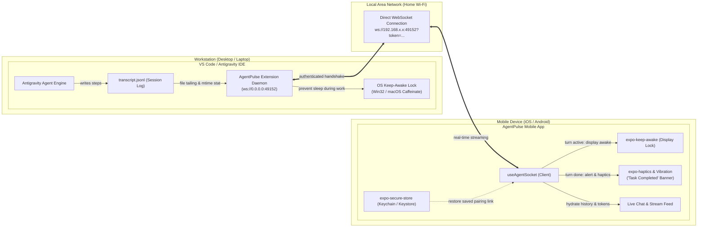

# AgentPulse Mobile (`agentpulse-mobile`)

> Modern, privacy-first mobile companion for supervising AI coding assistants (**Google Antigravity**) while away from your desk (AFK) on your local Wi-Fi network.

[](https://www.typescriptlang.org/)
[](https://expo.dev/)
[](https://reactnative.dev/)
[](https://opensource.org/licenses/MIT)
[](https://github.com/AnmolVerma404/AgentPulse-VS-Code)

---

## 🔗 Sister Repository

* **Desktop IDE Extension:** [AgentPulse-VS-Code (VS Code / Antigravity IDE)](https://github.com/AnmolVerma404/AgentPulse-VS-Code)

---

## 📱 Overview

When developers fire off long-running prompts in modern AI coding agents, they frequently step away from their desks. **AgentPulse Mobile** bridges your phone directly to your desktop development session over local Wi-Fi:

* **Live Stream Chat & Reasoning:** Read the agent's real-time thoughts, stream chunks, and executing tool calls.
* **Instant Completion Alerts:** Receive haptic pulses, vibration patterns, and a prominent banner when the agent completes its turn (`status: 'done'`), signaling that it is time to return to your desk.
* **Single Connection URI Pairing:** Simply copy the connection URI from your desktop extension (`ws://192.168.x.x:49152?token=...`) and paste it into one single input field.
* **Screen Keep-Awake:** Prevents iOS and Android from sleeping the display and suspending the WebSocket connection while the agent is actively `'thinking'` or `'running_tool'`.
* **Persistent Hardware Security:** Uses `expo-secure-store` to safely remember your LAN server URL, pairing token, and settings in your device's hardware enclave (iOS Keychain / Android Keystore) so you never need to re-type pairing details on every launch.
* **Automatic History Hydration:** Pulls recent conversation history on initial handshake (`INIT_SESSION`) so reconnecting never leaves you with an empty screen.
* **Zero Cloud Storage:** Direct device-to-workstation architecture over LAN. No prompts, code, or tokens are ever uploaded to cloud servers.

---

## 📸 Demo


<p align="center">
  <video src="https://github.com/user-attachments/assets/ae510464-4f61-4539-949b-d59d985af573" width="600" controls></video>
</p>

---

## 🤖 Supported AI Coding Assistants

| Assistant | Status | Notes |
| :--- | :---: | :--- |
| **Google Antigravity** |  **Supported** | Live thought streaming, tool execution indicators, history hydration, and completion alerts |
| **Other Coding Agents** | 🟡 *Planned* | Support for additional coding assistants is planned and will be coming in future updates |

---

## 📐 Architecture & Connection Flow



---

## 🛠️ Tech Stack

* **Framework:** React Native 0.88+ with Expo 58+
* **Language:** TypeScript (Strict Mode)
* **Storage:** `expo-secure-store` (Hardware Keychain / Keystore)
* **Display & Alerts:** `expo-keep-awake`, `expo-haptics`
* **Networking:** Native WebSockets
* **Testing:** Jest + `@testing-library/react-native` + `jest-expo`

---

## 🚀 Getting Started

### Prerequisites
* Node.js 20+ installed
* Workstation running [AgentPulse-VS-Code](https://github.com/AnmolVerma404/AgentPulse-VS-Code) on the **same local Wi-Fi router**
* Android phone (or emulator) or iPhone with **Expo Go** installed (free on App Store / Google Play)

### 1. Installation
```bash
# Navigate to mobile app directory
cd app

# Install dependencies
npm install
```

### 2. Running the Development Server
```bash
# Start Metro bundler
npx expo start
```

### 3. Launching on Devices
* **Physical iPhone / Android:** Open camera or the **Expo Go** app and scan the QR code displayed in your terminal.
* **Android Emulator:** Press <kbd>a</kbd> in terminal or run `npx expo start --android`.
* **iOS Simulator:** Press <kbd>i</kbd> in terminal or run `npx expo start --ios`.
* **Web (Testing):** Press <kbd>w</kbd> in terminal.

### 4. Pairing with Desktop
1. In your desktop IDE running [AgentPulse-VS-Code](https://github.com/AnmolVerma404/AgentPulse-VS-Code), run `AgentPulse: Copy Connection URI` (or click "Copy Connection URI" in the sidebar).
2. In the mobile app, tap **Pair** (or **Settings**) in the top-right corner.
3. Paste the single connection link into the **Connection URI** input:
   ```text
   ws://192.168.x.x:49152?token=...
   ```
4. Tap **Connect**. The app stores the credentials in hardware secure storage and begins streaming agent activity in real-time.

---

## 🧪 Testing & Quality Assurance

```bash
# Run unit and component test suites (27 tests passing)
npm test -- --watchAll=false

# Run TypeScript type check
npx tsc --noEmit
```

---

## 📁 Repository Structure

```
./
├── assets/                  # App icons and splash screens
├── src/
│   ├── components/          # AgentStatusBar, ChatMessageBubble, CompletionBanner, ConnectionModal, PromptBar, ToolApprovalCard
│   ├── hooks/               # useAgentSocket, useAgentKeepAwake, useCompletionAlert
│   ├── services/            # storage.ts (expo-secure-store wrapper)
│   └── types/               # TypeScript models (AgentExecutionStatus, ChatMessage, ToolCallRequest)
├── __tests__/               # Jest test suites (App, Components, KeepAwake, CompletionAlert, Storage)
├── App.tsx                  # Root application entrypoint
├── app.json                 # Expo configuration & plugins
├── AGENTS.md                # AI Agent guidelines & context cache
└── plan.md                 # Development roadmap and step checklist
```

---

## 🔒 Security Architecture

1. **Hardware Enclave:** All pairing tokens and host configurations are stored securely with `expo-secure-store`.
2. **Read-Only Inspection:** The mobile app acts strictly as an observation monitor. It cannot inject arbitrary commands or delete files on your workstation.
3. **No External Cloud:** All communication is direct peer-to-workstation over your private local area network (LAN).

---

## 📄 License

This project is licensed under the [MIT License](LICENSE).

